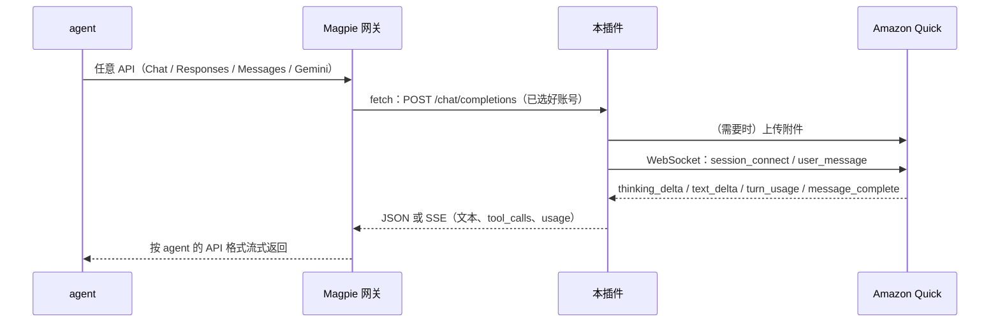

# 开发说明

[README](../README.md) 里只讲怎么用，这里是细节：全部选项、工作方式、代码结构、测试、发布和已知限制。

## 模型

这些是 Amazon Quick 的 agent mode，不是具体的模型名。我的账号上 fast、balanced、smart 实际分别由 Claude Haiku、Sonnet、Opus 回答（见每轮用量里的 `resolved_model_id`），其他账号可能不同。上下文长度按上游每轮用量里报告的 `context_window` 填为 1M；最大输出（fast 32k，其余 64k）是估计值，Amazon Quick 没有公布。推理档位 low / medium / high 对应上游的 `thinking_effort`。

## 全部选项

Magpie 里用 `magpie plugin options` 设置；CC Switch 模式写在 `~/.aws-quick-bridge/config.json` 的 `options` 里。

```sh
magpie plugin options magpie-AWS-Quick-bridge '{"thinking_effort": "medium", "timezone": "Asia/Shanghai", "locale": "zh-CN"}'
```

| 选项 | 默认 | 说明 |
|---|---|---|
| `thinking_effort` | 空 | 请求没有指定推理档位时使用：`off`、`low`、`medium`、`high`、`max`（`max` 为实测生效档，思考量约 `high` 的 2.4 倍；`xhigh` 上游不支持） |
| `default_model` | `smart` | 收到未知模型名时使用的 agent mode |
| `timezone` / `locale` | `UTC` / `en-US` | 发给上游的时区与语言 |
| `request_timeout` | `5m` | 单次上游请求超时（`30s`、`5m`、`1h`，或秒数） |
| `keep_sessions` | `false` | 对话进入 Amazon Quick 的聊天列表和记忆，而不是使用隐身线程（也可在供应商编辑页的插件选项里开关） |
| `web_search` | `false` | 允许 Amazon Quick 使用它自己的联网搜索；请求里的 `web_search_enabled` 优先 |
| `stateful` | `true` | 多轮对话复用服务端线程、只发新增消息；`false` 时每次请求重发全部历史 |
| `attachments` | `true` | 放不进一帧的内容和图片上传为附件；`false` 时改为截断较早的内容 |
| `max_frame_bytes` | `63000` | 一条消息（JSON，UTF-8 字节）的大小上限，超过就压缩或转附件；`0` 关闭这项处理 |
| `app_version` | `1.2.4660` | 上游握手使用的 appVersion |
| `surface` | `QUICK_WORK_DESKTOP_WINDOWS` | 上游握手使用的 surfaceType |
| `outpost_id` / `working_session_id` | 空 | 上游握手可选字段 |
| `callback_port` | `18080` | 本机 OAuth 回调端口；`0` 为任意空闲端口 |
| `login_timeout` | `30m` | 等待浏览器完成登录的时间 |
| `build_stage` | `prod` | `prod`、`beta`、`integ`、`dev` |
| `proxy` | 空 | 聊天 WebSocket 使用的代理地址（见下面的限制） |
| `oidc_base` / `discovery_url` / `data_plane_url` | 空 | 覆盖上游地址，仅用于测试（模拟上游） |

改动选项会重启插件宿主，从下一个请求起生效。

## Magpie：在另一台电脑上登录

浏览器访问不到服务器的 `localhost` 时：

1. 在自己的浏览器里打开登录说明中给出的 `https://quick.aws.com/sn?qwSurface=…` 地址并登录。
2. 浏览器会停在一个打不开的 `http://localhost:18080/callback?nonce=…` 页面。把地址栏里的**完整地址**粘贴回 Magpie（终端里直接粘贴后回车；应用里填进登录窗口的 Callback URL）。
3. Magpie 给出下一步要打开的 AWS 授权地址（终端里是一行 `Amazon Quick sign-in, next page to open: …`）。打开它并同意。
4. 浏览器停在 `http://127.0.0.1:18080/?code=…`，再把这个完整地址粘贴回 Magpie，登录完成。

也可以用 SSH 端口转发让回调直接可达：`ssh -L 18080:127.0.0.1:18080 <服务器>`。

## 登录信息存在哪里

存在 Magpie 配置目录的 `plugin-auth.json`（权限 600，`~/.config/magpie/` 或 `$XDG_CONFIG_HOME/magpie/`），包括 access token、refresh token、id token、OAuth client 的 id 和 secret，以及邮箱、租户地址等账号信息。登录密码只在 Amazon 的页面里输入，插件接触不到。`magpie plugin logout aws-quick` 删除它。


CC Switch 模式的账号和 Key 存在 `~/.aws-quick-bridge/`（目录 `0700`、文件 `0600`），`magpie-aws-quick-bridge logout` 删除账号。

## 工作方式



- 每个请求打开一条到 Amazon Quick 的 WebSocket，把要发送的消息转成一条 `user_message`：单条用户消息原样发送，多轮对话和工具结果按 `User:` / `Assistant tool call (...)` / `Tool result (...)` 渲染。
- 线程复用：Magpie 通过 `chat.headers` 钩子把会话 ID 带给插件；同一账号、同一会话、历史前缀一致的请求会接到上一轮的服务端线程上，只发新增消息，系统提示词没变也不重发。历史被改写（压缩、回退）或线程缓存过期（内存里保留 6 小时）时，开新线程重发全部历史。
- 64 KB 消息上限：我用真实账号测过，Amazon Quick 按消息 JSON 的 UTF-8 字节数计算（中文每个字 3 字节，系统提示词和正文算在一起），65250 字节能发，65300 字节被拒，所以默认按 63000 字节控制。超出时按这个顺序处理，直到放得下：工具说明逐级缩短（完整定义 → 一行签名，描述 160 字 → 60 字 → 不带描述 → 只列工具名）→ 缩短系统提示词 → 过长的对话内容转附件 → 截断较早的内容。工具再多也不会把超限的消息发出去；万一 Amazon Quick 仍然拒收，会自动缩小到 70% 再发一次。实在放不下（比如把 `max_frame_bytes` 设得很小）时直接在本地报错，不发送。附件经 Amazon Quick 的上传接口和 DLP 检查后挂到线程上，由模型用它自己的文件工具读取。
- 工具只在客户端执行：插件把模型输出的 `<client_tool_call>{"name":…,"arguments":…}</client_tool_call>` 转成 `tool_calls`，下一轮再把工具结果作为文本带回去。`tool_choice: "none"` 关闭桥接，指定函数时只接受该函数。带工具的每条消息末尾还会加一句提醒：文件和终端在用户自己的电脑上，要用上面的标记调用工具，Amazon Quick 自带的工具看不到这台电脑。没有这句时，`fast` 档常常直接去用自带工具找文件。
- 系统提示词放在 `custom_prompt` 里。agent 开头那句自报家门（如 “You are Claude Code, Anthropic's official CLI for Claude.”）会换成一句“这段对话来自用户电脑上的编程 agent”，Claude Code 的计费头那一行会去掉：Amazon Quick 不是这些产品，被要求扮演时容易纠结身份而不干活。
- 用户用中文、日文或韩文写的时候（看最近 4 条用户消息里用户自己打的字），带工具的请求会多一句说明：用这种语言思考和回复，工具参数里的文件名、路径、日志、报错和搜索词照原文抄，不要翻译。Amazon Quick 默认用英文思考，会把中文日志翻成英文再去搜，结果搜不到。
- 模型名里方括号的部分（如 Claude Code 的 `[1m]`）不算名字的一部分，`advanced[1m]` 就是 `advanced`。
- 出错时尽量用 Magpie 能处理的状态回答：上游拒绝登录回 401（账号被标记为需要重新登录），限流回 429，超时回 504，其他上游错误回 502，Magpie 据此切换到下一个账号或模型。回复开始之后的错误只能写进流里。

代码结构：

```
index.mjs            插件入口：config / provider.models / chat.headers / auth（登录、refresh、usage、loader）钩子
opencode.mjs         Magpie 与 OpenCode 1.x 加载的入口
opencode2.mjs        OpenCode 2.x 的入口（Magpie 社区仓库提供的适配器）
plugin/oauth.mjs     发现、IDC client 注册、PKCE、换 token、refresh、user-info
plugin/login.mjs     本机回调端口上的浏览器登录
plugin/upstream.mjs  一轮对话的 WebSocket 收发
plugin/wire.mjs      AIDP / Gateway 帧、AWS event-stream、CBOR
plugin/qbs.mjs       账号接口：额度、设置、附件上传
plugin/threads.mjs   请求与服务端线程的对应关系
plugin/messages.mjs  OpenAI 消息 → user_message 文本与 custom_prompt
plugin/toolbridge.mjs 客户端工具的文本协议与流式解析
plugin/chat.mjs      chat completions 的 JSON / SSE 回复
plugin/settings.mjs  选项与模型表（插件和本机 API 共用）
bin/cli.mjs          CC Switch 模式的命令行：login / serve / ccswitch / status / …
gateway/server.mjs   本机 API：Key 校验、路由、/v1/models
gateway/anthropic.mjs  Anthropic Messages ⇄ chat completions（Claude Code）
gateway/responses.mjs  OpenAI Responses ⇄ chat completions（Codex）
gateway/sse.mjs      把 chat completions 的回复读成事件
gateway/store.mjs    本机的 Key、账号文件和 token 续期
gateway/ccswitch.mjs CC Switch 导入链接
gateway/service.mjs  macOS 后台服务（launchd）
test/                单元测试、模拟上游、端到端测试
```

CC Switch 模式下没有 Magpie 网关：agent 直接请求本机 API，`gateway/` 把 Anthropic Messages 或 OpenAI Responses 转成 chat completions，再交给和插件相同的那套代码。

## 开发与测试

需要 [Bun](https://bun.sh)。

```sh
bun test                              # 单元测试 + 对模拟上游的端到端测试（插件和本机 API）
```

本机 API 也可以对着模拟上游单独跑起来，再让 Claude Code、Codex 或 `curl` 指向它：

```sh
export AWS_QUICK_BRIDGE_HOME=$(mktemp -d)        # 不碰 ~/.aws-quick-bridge
node bin/cli.mjs status                          # 生成 config.json，把模拟上游的选项写进它的 options
node bin/cli.mjs login && node bin/cli.mjs serve
```

在沙箱里的 Magpie 中试用，不会碰到你正在用的 Magpie、agent 和登录信息：

```sh
sb=$(mktemp -d)
m() { env HOME=$sb XDG_CONFIG_HOME=$sb/.config XDG_CACHE_HOME=$sb/.cache MAGPIE_ADDR=127.0.0.1:3499 magpie "$@"; }
m plugin add . </dev/null
m plugin --json                       # 登录方式、账号、模型、加载错误
m plugin login aws-quick              # 真实登录
m provider test aws-quick             # 发一个很小的请求
m plugin logout aws-quick
```

没有 Amazon Quick 账号时可以用仓库里的模拟上游走通整个流程（登录页、OIDC、user-info、聊天 WebSocket 都在本机）：

```sh
bun test/mock-upstream.mjs 39100      # 会打印下面要用的选项
m plugin options magpie-AWS-Quick-bridge '{"oidc_base":"http://127.0.0.1:39100","discovery_url":"http://127.0.0.1:39100/sn","data_plane_url":"http://127.0.0.1:39100"}'
m plugin login aws-quick
m provider test aws-quick
```

## 发布与上架

1. **版本**：改 `package.json` 的 `version`。
2. **npm**：`npm publish`。之后用户可以 `magpie plugin add magpie-aws-quick-bridge`，Magpie 插件页的搜索也能按 `opencode` 关键词找到它，详情页显示这份 README。
3. **GitHub 标签**：给仓库加上 `magpie-plugin` topic，几分钟后它会出现在 **插件 → 发现 → 非官方插件 · GitHub**。卡片的名字、简介和图标取自 `package.json` 的 `magpie.name`、`magpie.summary`、`magpie.icon`。发布到 npm 且 `repository` 指向本仓库时从 npm 安装，否则按仓库当前代码安装（插件加载的文件都已提交在仓库里）。
4. **推荐列表**：向 [magpie-community/plugins](https://github.com/magpie-community/plugins) 提一个 PR，在 `registry.json` 里加一项：

   ```json
   { "package": "magpie-aws-quick-bridge", "name": "Amazon Quick", "providers": ["aws-quick"],
     "icon": "https://raw.githubusercontent.com/DaBinBinah/magpie-AWS-Quick-bridge/main/assets/icon-128.png",
     "summary": { "en": "Amazon Quick (QuickWork) with browser sign-in for personal and enterprise accounts: streaming chat and client tool calls. Unofficial.",
                  "zh": "浏览器登录 Amazon Quick（QuickWork）个人或企业账号，支持流式对话与客户端工具调用。非官方。" } }
   ```

   `MAGPIE_PLUGIN_MARKET=<url>` 可以让 Magpie 改读另一份列表，用来在提 PR 前检查这一项。

`package.json` 里的 `magpie.icon` 是内嵌的 128px logo（data URI），所以从文件夹或 git 安装时也有图标；仓库公开后可以换成上面那样的 `https://` 地址。

## 限制

- **真实上游的验证范围**：我用自己的个人账号（social）对真实的 Amazon Quick 验证过浏览器登录、流式对话、系统提示词、思考输出、工具调用循环、线程复用、附件上传和额度查询；0.3.3 的中文日志搜索（Claude Code 的 `fast` 和默认档、Codex、Chat Completions）和带 `[1m]` 后缀的模型名也是对真实账号验证的。企业账号（IAM Identity Center）、`gateway` / `social_gateway` 的 CBOR 路径、advanced 模式和图片附件只对仓库里的模拟上游或单元测试验证过。在 Magpie 里的安装、登录、粘贴回调登录、经网关请求和 `magpie quota` 是对模拟上游验证的。
- **CC Switch 模式的验证范围**：在我的 Mac 上用真实账号让 Claude Code、Codex、OpenCode 经本机 API 完成了读文件、写文件的工具调用；企业账号登录和 macOS 后台服务没有用真实账号验证。Gemini CLI 用的是另一种接口格式，目前不支持。
- 只有聊天。`temperature`、`max_tokens`、`stop`、`response_format` 等采样参数不会传给上游；`n > 1` 返回 400。
- 输入是文本和 `data:` URL 形式的图片；远程图片地址、音频、文件会变成 `[image]`、`[audio]`、`[file]` 占位。
- Amazon Quick 会在每轮加上它自己的系统提示词和工具（我的账号上一条短消息约占 6.9 万输入 token，大部分命中缓存），插件无法去掉；额度按 Amazon Quick 的 credits 计。
- 内容转成附件后，模型要先用它自己的文件工具读取，这一轮会慢一些。
- 线程缓存在插件进程的内存里，Magpie 重启后下一次请求会重发全部历史。
- 工具桥接是文本协议，模型偶尔可能不遵守；回复以 `{`、`[` 或反引号开头时会先整段缓冲，以判断它是不是一个没带标记的工具调用。
- 代理：按 Magpie 的文档，插件用 `fetch` 发出的请求（登录、续期）走 Magpie 给供应商或账号设置的代理。聊天用的是 WebSocket，它是否也走这个代理没有验证过；需要时用 `proxy` 选项明确指定（如 `http://127.0.0.1:7890`）。
- OpenCode 2.x 的入口（`opencode2.mjs`）只通过了 Magpie 社区仓库的检查脚本，没有在 OpenCode 2.x 里实际运行过。
- 上游接口可能随官方客户端更新而变化；登录或聊天失败时先重新登录，必要时调整 `app_version`。
